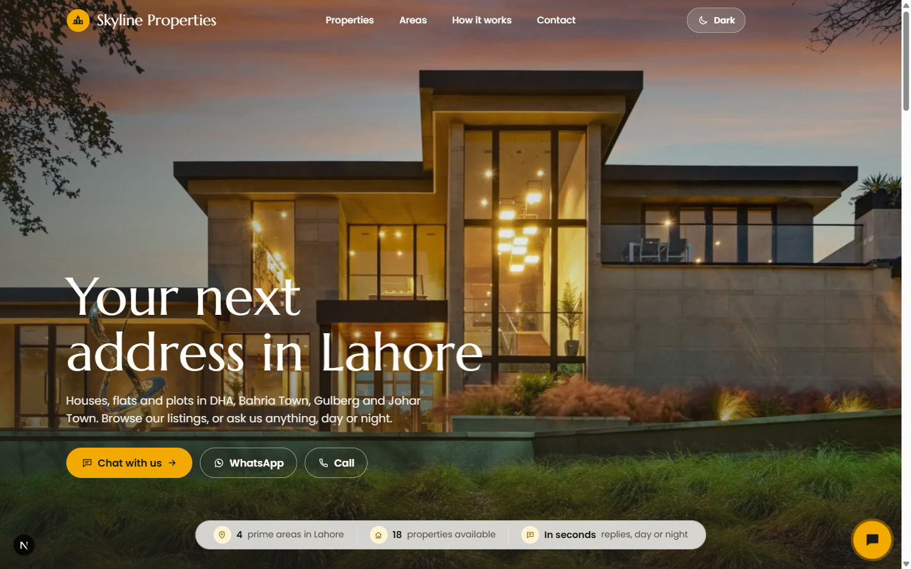
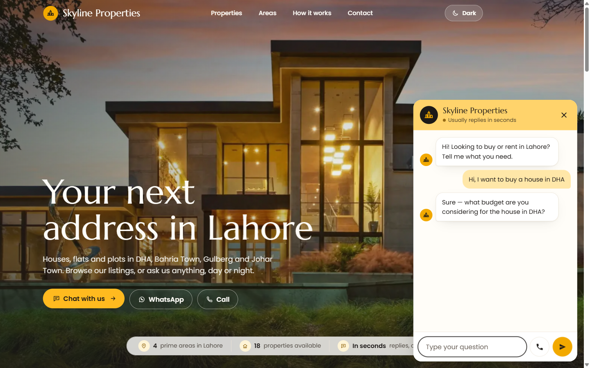
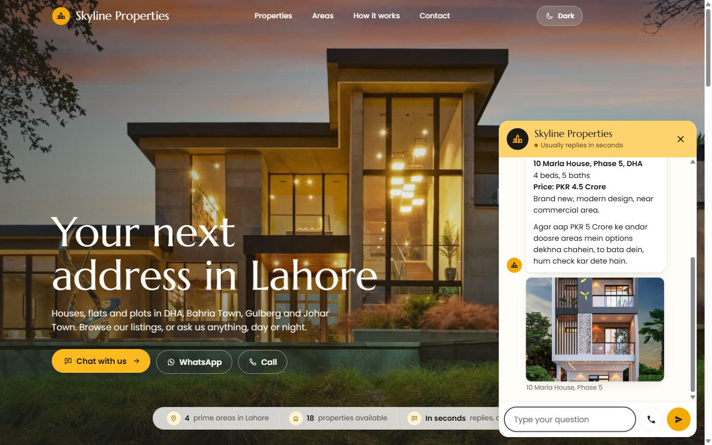
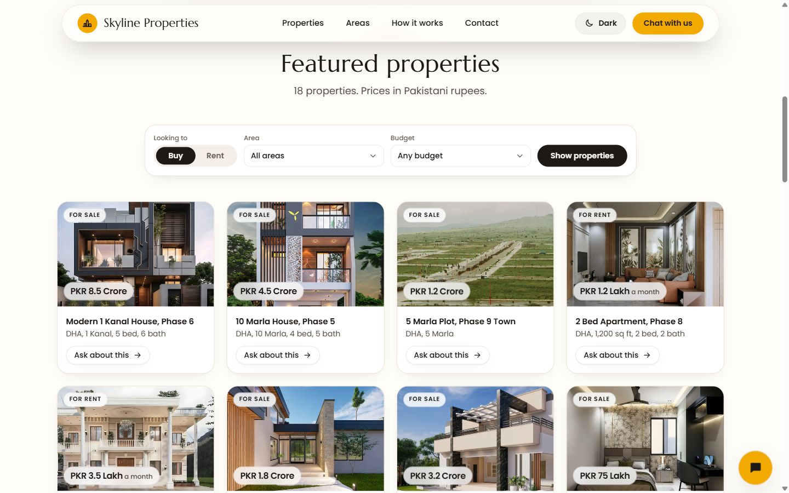
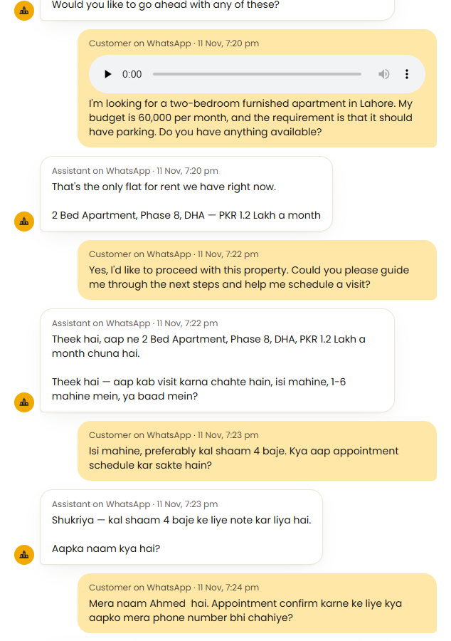
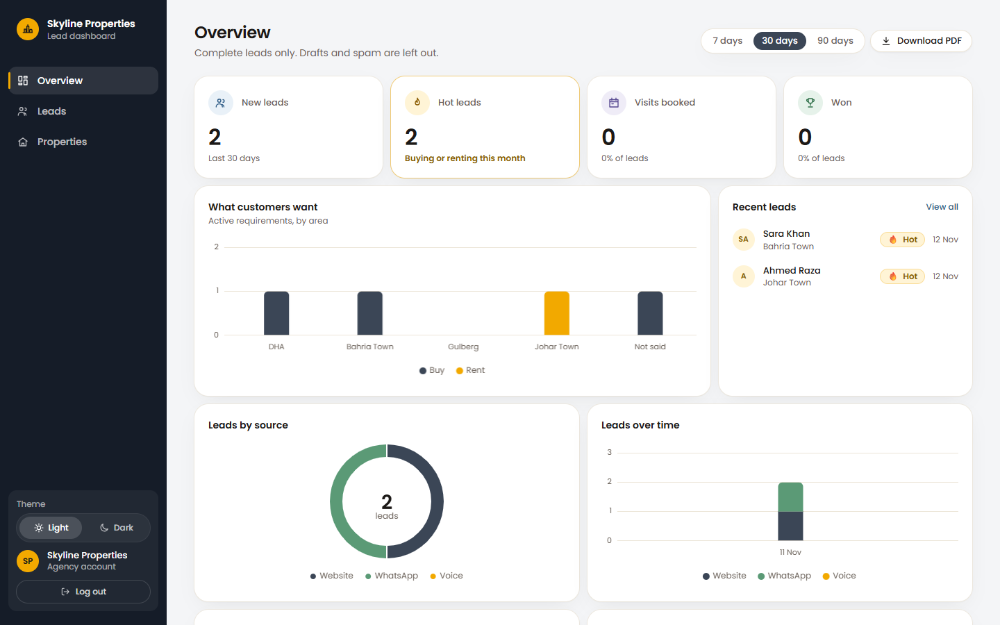
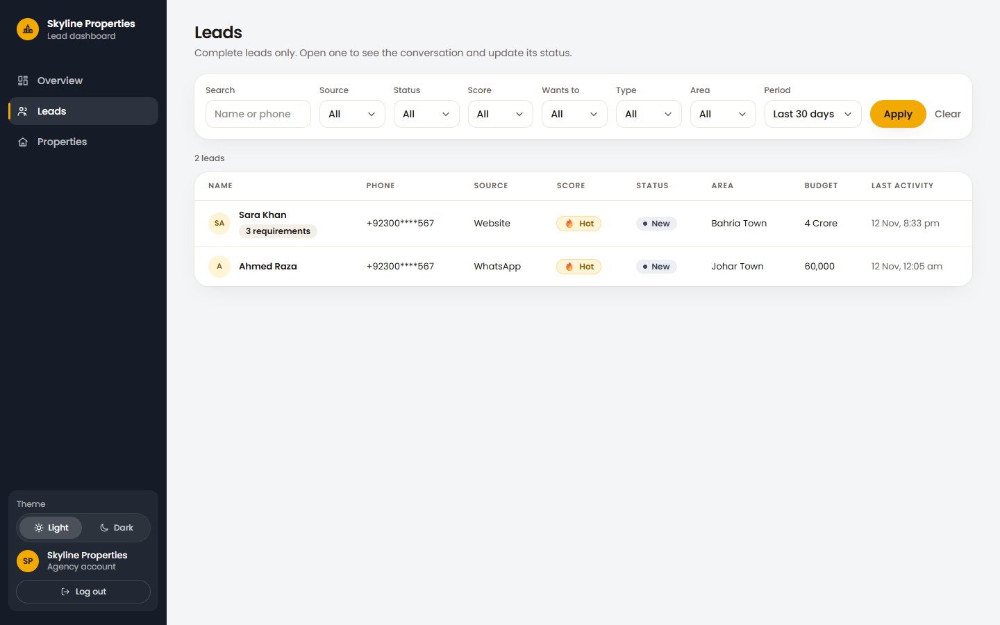
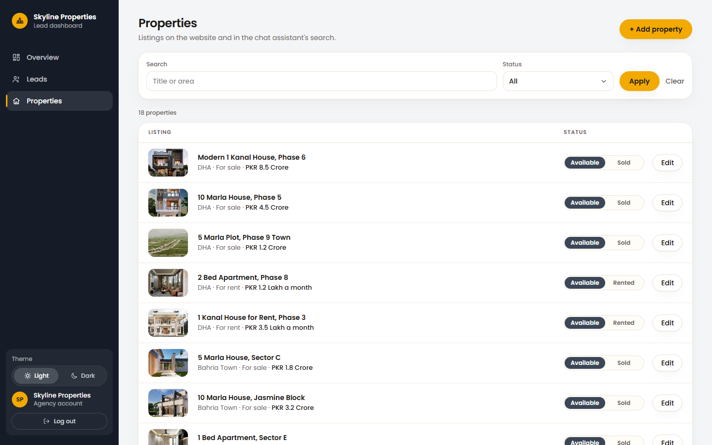
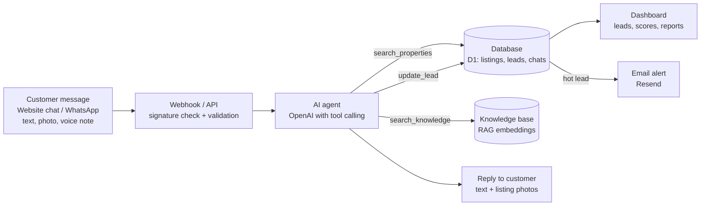

# Real Estate AI Lead System

An AI assistant that answers property buyers and renters on a website chat and on WhatsApp, day or night, finds matching listings, collects their details, and hands ready leads to the sales team.

Built for a real estate agency in Lahore, Pakistan. The demo agency, **Skyline Properties**, is made up; its listings and prices are sample data.

> **Live demo:** coming soon

---

## The problem

Real estate agencies lose leads every day:

- **Messages at night go unanswered.** A buyer asks about a house at 11 pm; by the morning they have asked three other agencies.
- **WhatsApp replies are slow.** Agents are busy with visits, so customers wait hours for a simple "what do you have in DHA under 5 crore?".
- **Details get lost.** Budget, area and timeline are scattered across chats, and nobody knows which lead is ready to buy now.

## What the system does

| Part | What it does |
|---|---|
| **Website chat** | A chat bubble on the agency website. It asks one question at a time (buy or rent, property type, area, budget), shows matching listings with photos, and collects name and phone. |
| **WhatsApp agent** | The same AI on the agency's WhatsApp number (via the YCloud WhatsApp API). It also understands **photos** customers send and **voice notes** (transcribed, then answered). |
| **AI voice agent** | A phone agent built with ElevenLabs that can answer calls and search listings. Built and tested; switched on per client. |
| **Dashboard** | A password-protected dashboard for the agency: all leads with their full conversation, a **Hot / Normal** score, filters, charts, a PDF lead report, and property management (add, edit, photos, mark sold or rented). |

Plus:

- **Instant email alerts:** when a lead is complete and wants to buy this month, it is marked **🔥 Hot** and the agency gets an email at once.
- **Knowledge base (RAG):** agency information (policies, area guides, buying and renting process, costs and fees, documents, FAQs for overseas buyers and instalments) is stored as embeddings, so the AI answers questions from the agency's own facts instead of guessing.
- **English, Urdu and Roman Urdu:** the assistant replies in the language of each message, e.g. "Mera budget 5 crore tak hai" gets a Roman Urdu answer.
- **Never invents listings:** every property the AI mentions comes from the database through a search tool. If nothing fits, it says so and offers other areas or budgets.

## Screenshots

**Website chat: the customer starts in English**

**...answers the budget in Roman Urdu, and gets a matching listing with its photo**

**Website listings with search**

**WhatsApp: the customer sends a voice note; the AI transcribes it, offers the matching flat and books the visit in Roman Urdu** (as seen in the dashboard)

**Dashboard overview: new and hot leads, what customers want, leads by source and over time**

**Leads list with filters and Hot score**

**Property management: the same listings the AI searches**

_Customer names and phone numbers in the screenshots are replaced with demo values._

## How it works

1. A message arrives from the website chat or WhatsApp (voice notes are transcribed first, photos are read by the AI).
2. The AI agent decides what to do and calls one of three tools: **search properties**, **search the knowledge base**, or **update the lead**.
3. Lead details are saved to the database as the conversation goes; a lead counts as complete only when all seven details are known.
4. The reply goes back to the customer, with listing photos where relevant. Hot leads trigger an email to the agency.

## Tech stack

- **Next.js** and **TypeScript**
- **Cloudflare Workers** (hosting), **D1** (database), **R2** (photo and file storage)
- **OpenAI**: tool calling, embeddings for RAG, speech-to-text for voice notes, image understanding
- **YCloud** WhatsApp Business API
- **ElevenLabs** (AI voice agent)
- **Resend** (email alerts)
- **Zod** (input validation)
- **Vitest**: 650 automated tests, plus a paid AI test set that checks real conversations

## Security

- Every incoming webhook is checked with its **signature** before anything runs.
- All input is **validated** (Zod), and customer messages are treated as untrusted (prompt-injection safe: the AI has only three narrow tools).
- Public endpoints are **rate-limited**.
- **No secrets in code**: all keys live in environment variables, server-side only.
- The dashboard needs a **password login** with a signed cookie.

---

**Source code is private.** Built by **Sadaqat Ali, Jenssair Technologies**. Available for client projects.

Contact: [github.com/SadaqatAliAI](https://github.com/SadaqatAliAI)
